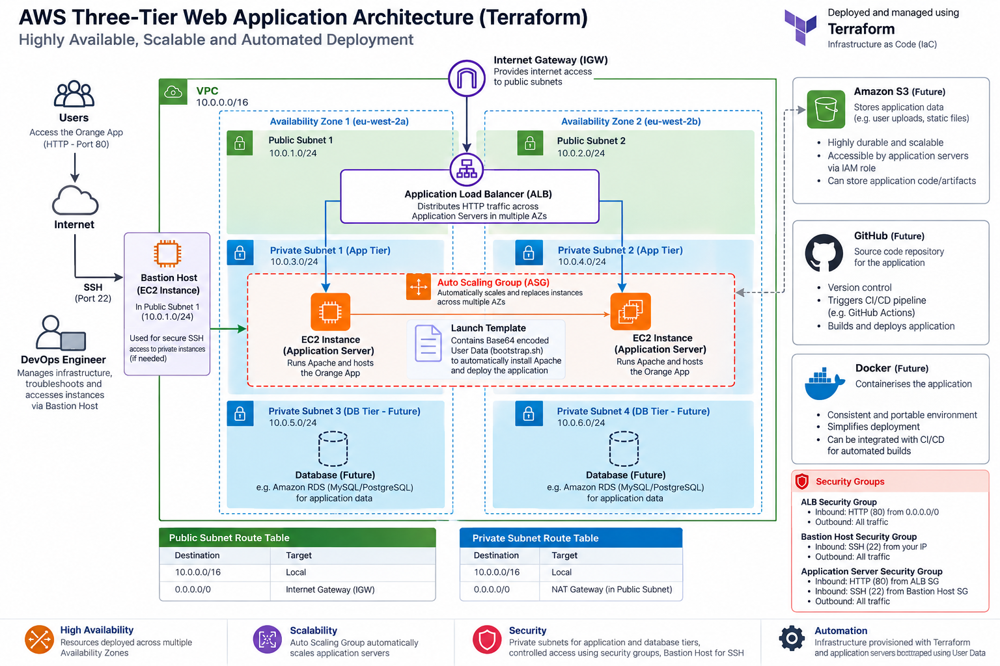
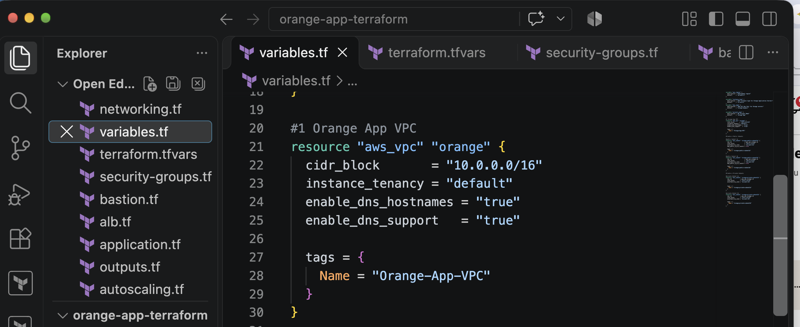
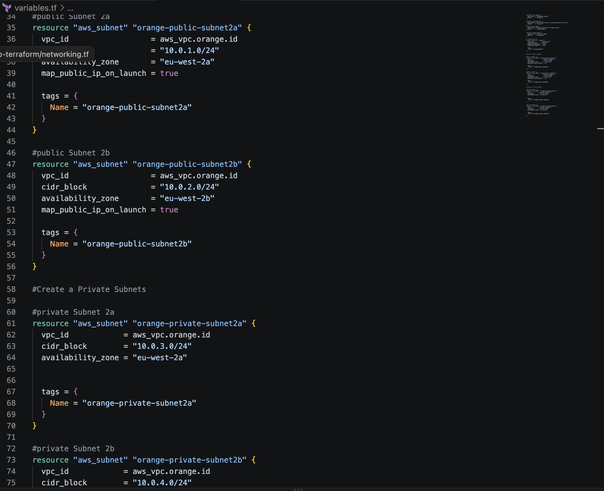
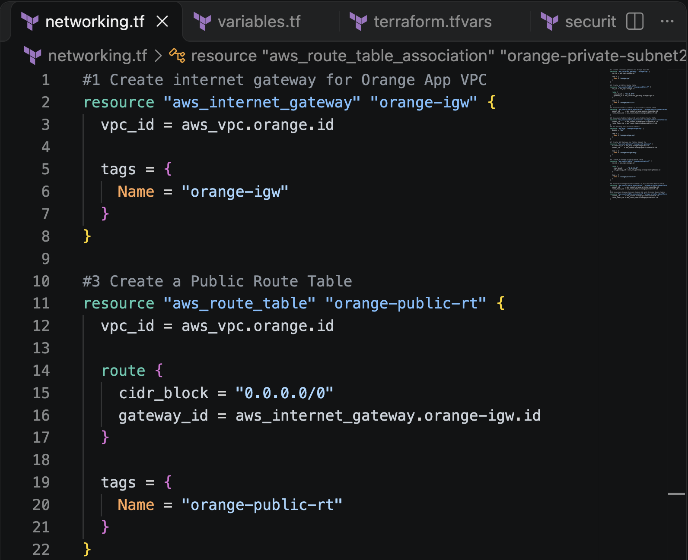

# Orange-App-AWS-Terraform
Building a scalable AWS application environment using Infrastructure as Code





**Project Overview**: This project documents my hands-on experience provisioning an AWS application environment using Terraform. Before this project, I had already built an AWS three-tier architecture manually using the AWS Management Console. Although that experience helped me understand how different AWS services work together, I wanted to take things further. Rather than relying on manual configuration, I wanted to define the infrastructure in code, organise it into separate configuration files and use Terraform to manage the dependencies between AWS resources.

This repository demonstrates my practical experience with Orange App Infrastructure with Terraform
The current Terraform configuration focuses on the public and private application infrastructure. A private database tier is planned as a future extension.

**Project Objectives**

1. Recreate my AWS application infrastructure using Terraform instead of manually configuring resources.
2. Deploy infrastructure across two AWS Availability Zones.
3. Separate public-facing resources from private application servers.
4. Configure secure communication between infrastructure components.
5. Introduce load balancing to distribute incoming HTTP traffic.
6. Use an Auto Scaling Group to manage application EC2 instances.
7. Configure automatic scaling based on CPU utilisation.
8. Automate Apache installation using a Bash bootstrap script and EC2 User Data.
9. Improve my understanding of Terraform dependencies, variables, resource references and state management.
10. Document the project professionally as part of my DevOps engineering portfolio.

**Architecture Diagram**

The diagram represents the intended network and application traffic paths. 
How the Architecture Works
When a user accesses the Orange App, the request reaches the internet-facing Application Load Balancer. The ALB listens for HTTP requests on port 80 and forwards them to the orange-tg Target Group. The Target Group is associated with an Auto Scaling Group responsible for managing EC2 application instances in two private subnets. A NAT Gateway provides outbound internet connectivity for private instances, allowing them to download packages without requiring public IP addresses. Administrative SSH access is provided through a Bastion Host in the public subnet for troubleshooting my Orange App Server. Security Groups control which components are permitted to communicate.

**Networking Infrastructure**

**Orange App VPC**
The foundation of the project is a custom VPC. The VPC provides the network environment for the application infrastructure.
DNS support and DNS hostnames are enabled to support communication between AWS resources.
The infrastructure is deployed in the AWS London Region:
Region: eu-west-2
Availability Zones: eu-west-2a and eu-west-2b
VPC: Orange-App-VPC
VPC CIDR: 10.0.0.0/16

**The Subnets**
I created four subnets across two Availability Zones.
Subnet	CIDR Block	Availability Zone	Purpose
Public Subnet 2a	10.0.1.0/24	eu-west-2a	Public infrastructure
Public Subnet 2b	10.0.2.0/24	eu-west-2b	ALB availability
Private Subnet 2a	10.0.3.0/24	eu-west-2a	Application EC2 instances
Private Subnet 2b	10.0.4.0/24	eu-west-2b	Application EC2 instances
The public subnets have routing through an Internet Gateway while the private subnets use a NAT Gateway for outbound internet access.

**Internet Gateway**
The Internet Gateway provides an internet routing path for resources in public subnets. The public route table contains a Public Route Table that is associated with both public subnets.

**NAT Gateway**
The NAT Gateway is provisioned in Public Subnet 2a and associated with an Elastic IP.
The private route table contains:
route {
  cidr_block     = "0.0.0.0/0"
  nat_gateway_id = aws_nat_gateway.orange-nat-gateway.id
}
This enables private application instances to initiate outbound internet connections.
What I learned: A private subnet is not defined simply by whether an instance has a public IP address. Route tables, gateway configuration and security rules all contribute to how network traffic flows.
Current limitation: Both private subnets use one NAT Gateway. This is sufficient for my learning environment but introduces a dependency on one Availability Zone for outbound connectivity.

🔐 2. Security Group Configuration
I created three Security Groups:
Security Group	Purpose	Key Inbound Rules
Orange-BastionHost-SG	Administrative access	SSH 22 from my public IP
Orange-App-ALB-SG	Public application entry point	HTTP 80 from the internet
Orange-App-SG	Private application servers	HTTP 80 from ALB SG; SSH 22 from Bastion SG
Application Security Group
The application Security Group uses another Security Group as the source for incoming HTTP traffic.
ingress {
  description = "HTTP from Orange-App-ALB"
  from_port   = 80
  to_port     = 80
  protocol    = "tcp"

  security_groups = [
    aws_security_group.orange-app-alb.id
  ]
}
This approach is more controlled than allowing inbound HTTP traffic from every public IP address.
The dedicated application Security Group also permits SSH access from the Bastion Host Security Group.
Configuration note: In the uploaded version of application.tf, the Launch Template still references the ALB Security Group. The intended configuration is to attach Orange-App-SG to application instances. This should be corrected and validated before publishing the repository as a completed deployment.

🖥️ 3. Bastion Host
I provisioned a Bastion Host using Terraform.
The Bastion Host runs Amazon Linux 2023 and is deployed in Public Subnet 2a.
Its main purpose is to provide a controlled administrative entry point for accessing EC2 instances in private subnets.
Why a Bastion Host?
Private application servers should not need public SSH access simply because an administrator needs to troubleshoot them.
The Bastion Host allows SSH access to be restricted to a known public IP address, while private application instances accept SSH traffic from the Bastion Security Group.
Terraform Resource
The Bastion Host is defined in:
bastion.tf
The configuration includes:
* Amazon Linux 2023 AMI.
* EC2 instance type.
* Public subnet placement.
* Bastion Security Group.
* Existing EC2 key pair.
* Public IPv4 address assignment.
* 8 GiB gp3 root volume.
What I learned: Administrative access and application access serve different purposes and should be controlled separately.
A future improvement is to explore AWS Systems Manager Session Manager to reduce reliance on public SSH access.

⚖️ 4. Application Load Balancer
I created an internet-facing Application Load Balancer named:
orange-app-alb
The ALB is deployed across the two public subnets.
It uses the Orange-App-ALB-SG Security Group.
Target Group
The application Target Group is named:
orange-tg
Configuration:
Property	Value
Protocol	HTTP
Port	80
Target type	Instance
Health check path	/
Expected status code	200
Health check interval	30 seconds
Healthy threshold	2
Unhealthy threshold	2
The ALB listener forwards HTTP requests to the Target Group.
Why Use an ALB?
Instead of exposing individual application servers directly, the ALB provides a central entry point.
It can distribute requests across healthy application instances and stop routing traffic to targets that fail health checks.
This separates the public-facing application endpoint from the private compute infrastructure.

📈 5. EC2 Auto Scaling
The application servers are managed by an Auto Scaling Group named:
Orange-App-ASG
Capacity Configuration
min_size         = 2
desired_capacity = 2
max_size         = 3
The ASG is configured to launch application instances in both private subnets.
It also uses ELB health checks with a 300-second grace period.
CPU Target Tracking
I configured an Auto Scaling policy targeting 60% average CPU utilisation.
resource "aws_autoscaling_policy" "orange_cpu" {
  name                   = "Orange-CPU-Scaling"
  autoscaling_group_name = aws_autoscaling_group.app.name
  policy_type            = "TargetTrackingScaling"

  target_tracking_configuration {
    predefined_metric_specification {
      predefined_metric_type = "ASGAverageCPUUtilization"
    }

    target_value = 60.0
  }
}
The policy allows AWS Auto Scaling to adjust capacity in response to CPU utilisation, within the configured ASG limits.
Rolling Instance Refresh
I also configured an instance-refresh strategy.
instance_refresh {
  strategy = "Rolling"

  preferences {
    min_healthy_percentage = 50
    instance_warmup        = 180
  }
}
This provides a mechanism for gradually replacing instances when supported ASG configuration changes trigger a refresh.
What I learned: An Auto Scaling Group manages desired instance capacity, while scaling policies define when AWS should adjust that capacity.
Validation: Load testing and simulated instance-failure testing are useful next steps to demonstrate that scaling and recovery behave as intended.

⚙️ 6. EC2 Launch Template and Application Bootstrapping
The application Launch Template is defined in:
application.tf
It specifies:
* Amazon Linux 2023.
* EC2 instance type.
* EC2 key pair.
* Application instance tags.
* Security Group configuration.
* EC2 User Data integration as the next configuration improvement.
Apache Bootstrap Script
I created a Bash script named:
bootstrap.sh
The script is responsible for:
1. Updating the operating system packages.
2. Installing Apache HTTP Server.
3. Starting Apache.
4. Enabling Apache to start automatically.
5. Creating the Orange App HTML webpage.
A simplified version:
#!/bin/bash
set -euxo pipefail

dnf update -y
dnf install -y httpd

systemctl enable --now httpd

echo "<h1>Welcome to Orange 3-Tier Application</h1>" \
  > /var/www/html/index.html
Integrating the Script with Terraform
The Launch Template can execute the script using EC2 User Data.
user_data = base64encode(
  file("${path.module}/bootstrap.sh")
)
If the script is stored in a scripts directory, the path should instead be:
user_data = base64encode(
  file("${path.module}/scripts/bootstrap.sh")
)
Terraform reads the file and Base64-encodes it for the EC2 Launch Template.
When a new EC2 instance launches, cloud-init can execute the script automatically.
Why This Matters
Manually configuring Apache on every new EC2 instance would make instance replacement more difficult.
Automated bootstrapping allows newly launched instances to receive a consistent initial application configuration.
Current repository note: The original uploaded application.tf does not contain the User Data block. This section documents the integration being added; the updated code should be committed once tested.

🧩 7. Terraform Project Structure
I organised the Terraform configuration into separate files to make the infrastructure easier to understand and maintain.
orange-app-terraform/
│
├── alb.tf
├── application.tf
├── autoscaling.tf
├── bastion.tf
├── bootstrap.sh
├── instances.tf
├── networking.tf
├── outputs.tf
├── providers.tf
├── security-groups.tf
├── variables.tf
│
├── terraform.tfvars.example
├── .gitignore
├── README.md
│
└── images/
    └── orange-app-architecture.png
File Responsibilities
File	Responsibility
providers.tf	AWS provider configuration
variables.tf	Reusable Terraform input variables
networking.tf	VPC routing, Internet Gateway, NAT Gateway and route tables
security-groups.tf	Network access controls
bastion.tf	Bastion Host EC2 instance
alb.tf	Application Load Balancer, Target Group and listener
application.tf	AMI lookup and application Launch Template
autoscaling.tf	Auto Scaling Group and CPU scaling policy
instances.tf	Additional standalone EC2 resource in the current configuration
bootstrap.sh	Apache installation and application setup
outputs.tf	Infrastructure outputs
terraform.tfvars.example	Example deployment values
An Important Terraform Concept
Although the infrastructure is divided into different files, Terraform treats all .tf files in the same directory as one root module.
Terraform determines resource creation order primarily through dependencies, not file names.
For example:
vpc_id = aws_vpc.orange.id
This reference tells Terraform that the resource depends on the Orange VPC.

🚀 8. Deployment Guide
Prerequisites
Before deploying, ensure you have:
* An AWS account.
* Terraform installed.
* AWS CLI installed and configured.
* AWS credentials with appropriate permissions.
* An EC2 key pair in eu-west-2.
* A public IPv4 address for Bastion SSH access.
Step 1 — Clone the Repository
git clone <YOUR_REPOSITORY_CLONE_URL>

cd orange-app-terraform
Step 2 — Configure Variables
Create a local terraform.tfvars file based on the example configuration.
Update the EC2 key pair name and administrator IP address to match your environment.
Do not commit real credentials, private keys or sensitive Terraform state files.
Step 3 — Initialise Terraform
terraform init
This initialises the working directory and installs the required AWS provider.
Step 4 — Format the Configuration
terraform fmt -recursive
Step 5 — Validate the Configuration
terraform validate
Step 6 — Review the Deployment Plan
terraform plan
Review the resources Terraform intends to create.
Step 7 — Deploy
terraform apply
Terraform will display the proposed infrastructure changes and request confirmation.
Step 8 — Retrieve the Application URL
terraform output orange_app_url
Once the application instances are healthy and Apache has started, use the ALB URL to access the Orange App.
Step 9 — Verify the Application
Check:
* EC2 application instances are running.
* The ALB Target Group reports healthy targets.
* The application responds through the ALB DNS name.
* Apache is running on the application servers.
* Private subnet routing works as intended.
* The Auto Scaling Group maintains its desired capacity.
If an instance fails during bootstrapping, inspect:
sudo systemctl status httpd
sudo cat /var/log/cloud-init-output.log
Step 10 — Clean Up
To remove the Terraform-managed infrastructure:
terraform destroy
Warning: This deletes managed infrastructure and may cause data loss. Review the destruction plan before confirming.
AWS resources such as NAT Gateways, ALBs, EC2 instances and public IPv4 addresses can generate charges while deployed.

🛠️ 9. Challenges and Lessons Learned
This project wasn't just about writing Terraform configuration files.
I encountered several problems that helped me understand how Terraform works.
Challenge 1 — Duplicate Variable Declaration
I initially declared the same Terraform variable in more than one file.
Terraform returned a duplicate variable declaration error.
What I learned:
Terraform loads all .tf files within the same module together. A variable can only be declared once within that module.
I learned to keep shared input variables organised in variables.tf.
Challenge 2 — Undeclared Resource References
I encountered errors when Terraform couldn't locate referenced Security Groups and route-table associations.
What I learned:
Terraform resource addresses must match the declared resource type and label.
An AWS resource's Name tag is different from the Terraform resource label used in code.
This helped me become more careful with naming conventions and resource references.
Challenge 3 — Understanding Network Dependencies
The NAT Gateway depends on public networking, and the application instances depend on the private subnet configuration.
What I learned:
Terraform builds a dependency graph using resource references.
For some resources, explicit depends_on declarations are useful when an operational dependency is not otherwise expressed through an attribute reference.
Challenge 4 — Automating Application Configuration
Manually installing Apache on individual EC2 instances is not ideal when instances are managed by an Auto Scaling Group.
My approach:
I created a Bash bootstrap script and worked on integrating it into the Launch Template using Base64-encoded User Data.
This introduced me to repeatable instance configuration.
Challenge 5 — Working with Local Files in Terraform
When referencing bootstrap.sh, Terraform reported that the file could not be found.
What I learned:
The file() function reads a file from the Terraform execution environment.
The path must correctly point to an existing file included with the configuration.
This reinforced the importance of repository structure and relative paths.

🧠 10. Key Skills Demonstrated
Through this project, I've gained practical experience in:
Infrastructure as Code
Writing and organising Terraform configurations, understanding dependencies, reviewing execution plans and managing infrastructure changes.
AWS Networking
Designing VPCs, subnets, gateways, route tables and network communication paths.
Cloud Security
Configuring Security Groups, controlling SSH access and separating public infrastructure from private application resources.
Compute and Scaling
Using EC2 Launch Templates, Auto Scaling Groups, target groups and scaling policies.
Linux and Automation
Working with Amazon Linux, Apache HTTP Server, Bash scripts and EC2 User Data.
Troubleshooting
Investigating Terraform configuration errors, resource-reference issues, network dependencies and application bootstrapping problems.

🔭 11. Future Improvements
This project is part of my ongoing DevOps learning journey.
My next improvements include:
Complete the Database Tier
Introduce Amazon RDS MySQL in private database subnets and connect it to an application backend.
Improve Application Deployment
Complete and verify User Data integration, then explore versioned application artifacts stored in Amazon S3.
Introduce CI/CD
Use GitHub Actions or Jenkins to automate Terraform formatting, validation and deployment workflows
